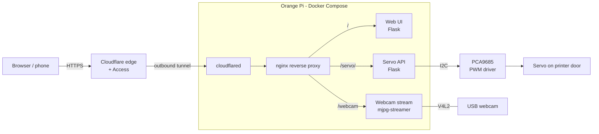

# Remote 3D Printer Door Controller

A self-hosted system that lets me open and close the door of my Bambu Lab P1S
from anywhere and watch the print over a live webcam feed. It runs on an
Orange Pi single-board computer, drives a servo through a PCA9685 PWM board I
wrote my own driver for, and is reachable securely over the internet through a
Cloudflare Tunnel, with no ports opened on my home network.

<!-- TODO: add a photo of the setup and a screenshot of the web page here, e.g.

-->

## How it works



1. I open the control page on my phone or laptop.
2. Cloudflare authenticates the request and forwards it down an **outbound-only
   tunnel** to the Pi, so the home router has no port forwarding.
3. **nginx** routes each path to the right container: the web page, the servo
   API, or the camera stream.
4. Pressing **Open** or **Home** sends a POST to the servo API, which writes the
   new pulse width to the PCA9685 over I2C, and the servo moves the door.
5. The page embeds the live MJPEG stream so I can watch the door and the print.

## Tech stack

| Layer | Tools |
|---|---|
| Hardware | Orange Pi, PCA9685 16-channel PWM board, hobby servo, USB webcam, MOSFETs and capacitors for servo power |
| Services | Python 3.11, Flask, smbus2, mjpg-streamer |
| Infrastructure | Docker, Docker Compose, nginx, Cloudflare Tunnel (cloudflared) |
| Front end | HTML, CSS, vanilla JavaScript |

## What I built

### PCA9685 driver, written from the datasheet
Rather than use an existing library, I wrote a small I2C driver
([`servo/pca9685.py`](servo/pca9685.py)) that talks to the chip's registers
directly:

- **Sets the PWM frequency** by putting the chip to sleep, writing the prescale
  register (`25 MHz / (4096 × freq) − 1`, 50 Hz for servos), then waking and
  restarting it with register auto-increment on.
- **Converts angles to pulse widths:** at 50 Hz each of the 4096 ticks is about
  4.9 µs, so 0–180° maps to roughly 204–410 ticks (about 1.0–2.0 ms pulses).
- **Writes all four ON/OFF bytes for a channel** in a single block write.

### Servo power circuit
I wired the servo power myself instead of drawing it from the Pi, using MOSFETs
to switch the servo supply and capacitors to absorb the current spikes servos
draw when they start moving. This keeps the Pi stable and stops the servo
jittering.

<!-- TODO: add part numbers, supply voltage, and a schematic or wiring photo,
e.g.  -->

### Servo control API
A Flask service ([`servo/main.py`](servo/main.py)) exposes
`POST /servo/<name>/open` and `POST /servo/<name>/home`. Servos are defined in a
name-to-channel map, so adding another servo means adding one line and a card on
the web page. The container gets access to the I2C bus through Docker device
passthrough (`/dev/i2c-1`).

### Live webcam stream
The webcam container builds mjpg-streamer from source and serves a 640×480,
30 fps MJPEG stream from the camera passed in as `/dev/video1`. In nginx I turned
off proxy buffering for this route so the stream plays smoothly instead of
stalling.

### Web interface
A lightweight, mobile-friendly control page
([`webpage/index.html`](webpage/index.html)) with per-servo control cards, the
embedded camera feed, and automatic dark/light theme based on system settings.
Buttons briefly disable after a press to avoid double commands.

### Secure remote access
- **Cloudflare Tunnel:** the Pi makes an outbound connection to Cloudflare, so
  nothing on the home network is exposed and there is no public IP to find.
- **Cloudflare Access** sits in front of the site so only I can reach the
  controls.
- **nginx** is the single entry point inside the Docker network; the individual
  services are not reachable from outside it.
- The tunnel token is kept in a `.env` file that is never committed.

## Challenges and what I learned

- **Servo power is a hardware problem, not a software one:** early jitter and
  instability came from power draw, which I solved with a dedicated supply,
  MOSFET switching and decoupling capacitors.
- **Getting hardware into containers:** passing the I2C bus and the video device
  into Docker, and working out the permissions each one needed.
- **Streaming through a reverse proxy:** MJPEG needs buffering disabled and the
  right path rewriting to work behind nginx.
- **Exposing a home device safely:** using a tunnel and an identity layer rather
  than port forwarding.

## Running it

Requirements: a Linux single-board computer with I2C enabled, Docker and Docker
Compose, a PCA9685 at address `0x40` on I2C bus 1, a USB webcam, and a
Cloudflare account with a tunnel set up.

```bash
git clone <this repo>
cd <this repo>
echo "CLOUDFLARED_TOKEN=your-tunnel-token" > .env
docker compose up -d --build
```

In the Cloudflare dashboard, point the tunnel's public hostname at
`http://proxy:80`. If your camera shows up as a different device, change
`/dev/video1` in `docker-compose.yml` and `webcam/start_stream.sh`.

## Project structure

```
├── docker-compose.yml     # all five services on one bridge network
├── cloudflared/           # Cloudflare Tunnel client
├── proxy/                 # nginx reverse proxy config
├── servo/                 # PCA9685 driver + Flask servo API
├── webcam/                # mjpg-streamer build and start script
└── webpage/               # Flask app serving the control page
```

## Ideas for next steps

- Open the door automatically when a print finishes, using the printer's local
  status API.
- Add more servos (the API and page are already set up for multiple).
- Add a door-position sensor so the page shows whether the door is actually open.
